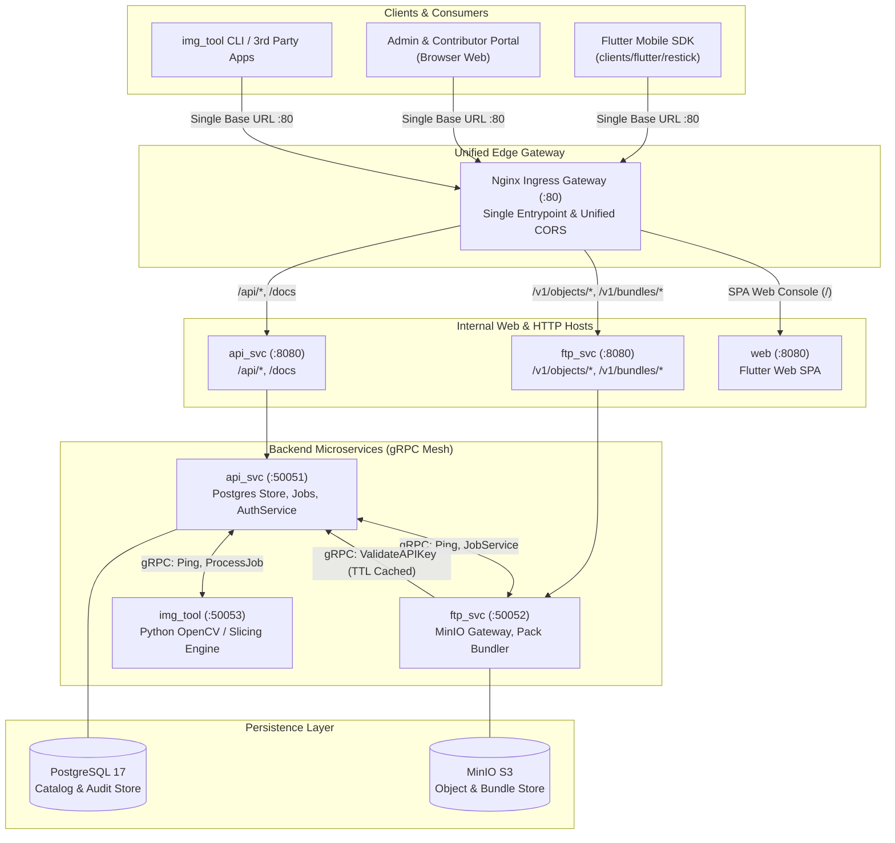

<p align="center">
  
</p>

<h1 align="center">Restick</h1>

<p align="center">
  <strong>End-to-End Enterprise Sticker Management Platform & Mobile Flutter SDK</strong>
</p>

<p align="center">
  <a href="https://github.com/DangDDT/restick/actions"></a>
  <a href="https://golang.org"></a>
  <a href="https://flutter.dev"></a>
  <a href="https://www.python.org"></a>
  <a href="https://grpc.io"></a>
  <a href="https://pub.dev/packages/restick"></a>
  <a href="LICENSE"></a>
</p>

---

## 📖 Overview

**Restick** is a production-ready, microservices-backed platform for managing, moderating, processing, and distributing high-quality sticker assets to mobile and web applications.

> [!NOTE]
> Restick is **not** an AI image generator. It handles real graphic assets: accepting raw sticker sheets or individual PNG/WebP files, automatically slicing and contour-detecting individual stickers, standardizing them to optimized 512x512 transparent WebP, hosting an editorial review queue, and serving optimized pack bundles and tombstone deltas directly to client applications.

---

## 🏗️ Architecture



---

## 📦 Repository Structure

| Directory | Type | Role | Technology Stack |
| :--- | :--- | :--- | :--- |
| [`services/gateway`](services/gateway/) | Edge Gateway | Nginx Ingress proxy, single entrypoint, zero-buffering asset streaming, CORS unification | Nginx 1.27 Alpine, HTTP/2, Stream Proxy |
| [`services/api`](services/api/) | Backend Service | Core catalog, user auth, moderation workflow, API key lifecycle, database migrations | Go 1.25, Chi Router, pgx/PostgreSQL, gRPC |
| [`services/ftp`](services/ftp/) | Backend Service | High-throughput object gateway, ZIP pack bundle streaming, gRPC API key auth caching | Go 1.25, MinIO Go SDK, gRPC, in-memory TTL cache |
| [`services/img_tool`](services/img_tool/) | Worker & CLI | Automated sticker sheet slicing, contour detection, padding & 512x512 WebP normalization | Python 3.12, OpenCV Headless, Pillow, Typer, gRPC |
| [`clients/web`](clients/web/) | Web Application | Contributor workspace, admin moderation console, rejection analytics, API key management | Flutter 3.47+ Web, Retrofit, Flutter BLoC, Drift SQLite |
| [`clients/flutter/restick`](clients/flutter/restick/) | Mobile SDK | Official Flutter SDK for embedding sticker pickers, marketplace, offline caching & sync | Dart / Flutter, Drift, Dio, Retrofit, Secure Storage |
| [`contracts/proto`](contracts/proto/) | Protocol Buffers | Shared gRPC & Protobuf definitions for inter-service communication | Protobuf v3, protoc, Go & Python plugins |
| [`infra`](infra/) | Infrastructure | Docker Compose definitions for PostgreSQL 17 and MinIO S3 object storage | Docker Compose |

---

## 🚀 Quickstart (All Services with Docker Compose)

### 1. Prerequisites
- Docker Engine 24+ & Docker Compose v2.20+
- Flutter 3.47.0+ (if developing web or mobile clients locally)
- Go 1.25+ & Python 3.12+ (if developing backend services locally)

### 2. Configure Environment
Clone the repository and create your `.env` configuration:
```bash
git clone https://github.com/DangDDT/restick.git
cd restick
cp .env.example .env
```

### 3. Build & Launch
Build Flutter Web artifacts and start all containers:
```bash
# Build Flutter Web release assets
cd clients/web && flutter build web --release --dart-define-from-file=configuration.dev.json && cd ../..

# Start all services & unified gateway on port 80
docker compose up --build -d
```

### 4. Health Checks
Verify the single gateway and services are up and healthy:
```bash
curl -s http://localhost/healthz          # gateway: {"status":"ok","service":"gateway"}
curl -s http://localhost/api/v1/packs     # api_svc: {"error":{"code":"unauthorized",...}}
curl -s http://localhost:8090/healthz     # img_tool: {"status":"ok","service":"img_tool"}
curl -s -I http://localhost/              # web: HTTP/1.1 200 OK
```

Access the **Admin & Contributor Web Portal** at **[http://localhost](http://localhost)**:
- **Default Admin Account**: `admin@restick.local`
- **Default Password**: `changeme` (configured via `BOOTSTRAP_ADMIN_PASSWORD` in `.env`)
- **Default API Key**: `dev-api-key`

---

## 🔑 Authentication & API Key Management

Restick provides a multi-tiered security model:

1. **User Authentication (JWT Bearer Token)**:
   - Contributor and Admin registration/login via `/api/v1/auth/register` and `/api/v1/auth/login`.
   - JWT tokens used for authenticated web dashboard actions.
2. **Dynamic API Keys (`rstk_live_...`)**:
   - Users and admins can provision personal API keys via `/api/v1/me/api-keys` or the Web UI.
   - Raw key token is revealed **strictly once** upon generation or rotation.
   - Keys are stored hashed with SHA-256 in PostgreSQL; clients authenticate via `X-Api-Key: rstk_live_<hex>` header.
   - Instant rotation (`POST /api/v1/me/api-keys/{id}/rotate`) and hard revocation (`DELETE /api/v1/me/api-keys/{id}`).
3. **Cross-Service gRPC Auth Validation**:
   - `ftp_svc` validates client API keys on the fly by calling `api_svc`'s `AuthService.ValidateAPIKey` RPC, caching valid tokens in memory with a 60-second TTL to avoid database bottlenecks.

---

## 🌐 Multi-Node Distributed Deployment

Each service can be deployed independently across different physical servers or VMs:

```bash
# Machine 1: Database & Core API
docker compose -f infra/postgres/docker-compose.yml -f services/api/docker-compose.yml up -d --build

# Machine 2: MinIO & Asset Delivery Gateway
API_SVC_GRPC_ADDR=192.168.1.10:50051 \
docker compose -f infra/minio/docker-compose.yml -f services/ftp/docker-compose.yml up -d --build

# Machine 3: Image Processing Worker
API_SVC_GRPC_ADDR=192.168.1.10:50051 \
FTP_SVC_GRPC_ADDR=192.168.1.11:50052 \
docker compose -f services/img_tool/docker-compose.yml up -d --build
```

---

## 🛠️ Developer Tooling

### Rebuilding Protocol Buffers
When updating contracts in `contracts/proto/`:
```bash
./scripts/gen-proto.sh
```

### Static Analysis & Verification Loop
```bash
# Backend Go code
cd api_svc && go test ./... && go vet ./...
cd ../ftp_svc && go test ./... && go vet ./...

# Frontend Web
cd clients/web && flutter analyze

# Flutter SDK
cd clients/flutter/restick && flutter analyze
```

### OpenAPI / Swagger Documentation
Interactive Swagger UI is embedded in the web dashboard or available at `api_svc/internal/interfaces/http/docs/openapi.yaml`.

---

## 📄 License

This project is licensed under the MIT License - see the [LICENSE](LICENSE) file for details.

