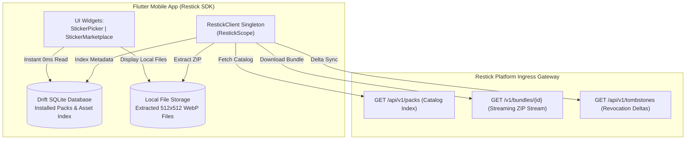

# Restick Flutter SDK

<p align="center">
  <a href="https://pub.dev/packages/restick"></a>
  <a href="https://pub.dev/packages/restick/score"></a>
  <a href="https://flutter.dev"></a>
  <a href="LICENSE"></a>
</p>

Official Flutter client SDK for the **Restick Platform**. Provides drop-in sticker marketplaces, keyboard pickers, offline ZIP bundle caching, and automatic delta tombstone synchronization for mobile messaging and social applications.

---

## ✨ Key Features

- 🛍️ **Ready-to-Use Sticker Marketplace (`StickerMarketplace`)**: Beautiful UI for browsing, searching, and previewing sticker packs with animated download progress bars.
- 🎨 **Sticker Picker & Keyboard (`StickerPicker`)**: High-performance sticker grid featuring emoji category tabs, in-memory caching, search, and recent stickers tracking.
- 📦 **Offline-First ZIP Caching**: Downloads complete `.zip` sticker archives, extracts optimized `.webp` assets to local disk, and indexes them in a local Drift SQLite database. Zero latency for sending downloaded stickers!
- 🔄 **Delta Tombstone Synchronization**: Automatically detects and purges revoked or deleted packs across app launches without redownloading the entire catalog.
- 🔐 **Secure API Key Auth**: Built-in support for Restick dynamic API keys (`rstk_live_...`) with optional hardware keystore/keychain persistence.
- ⚡ **Lightweight & Modular**: Clean separation between UI presentation widgets and the low-level `RestickClient` programmatic API.

---

## 🏗️ Architecture & Storage Flow



---

## 📦 Installation

### Option A: Via OnePub Private Registry (Recommended)

1. Authenticate with OnePub (one-time setup per developer or CI machine):
```bash
dart pub global activate onepub
onepub login
```

2. Add `restick` to your app's `pubspec.yaml`:
```yaml
dependencies:
  flutter:
    sdk: flutter
  restick:
    hosted:
      url: https://onepub.dev/api/xdhdsdavuh
      name: restick
    version: ^0.1.5-flutter3.32.8
```

### Option B: Via Git Repository
```yaml
dependencies:
  flutter:
    sdk: flutter
  restick:
    git:
      url: https://github.com/DangDDT/restick.git
      path: clients/flutter/restick
      ref: main
```

---

## 🚀 Quickstart & Setup

### 1. Initialize the SDK in `main.dart`

Call `Restick.open()` before `runApp()` to initialize the database, network client, and background sync worker:

```dart
import 'package:flutter/material.dart';
import 'package:restick/restick.dart';

Future<void> main() async {
  WidgetsFlutterBinding.ensureInitialized();

  // Initialize Restick Client
  final RestickClient client = await Restick.open(
    RestickConfig(
      baseUrl: 'https://restick.your-domain.com', // Your unified gateway domain
      apiKey: 'rstk_live_3f9b8a1c4e2d7f0e5b8a1c4e2d7f0e5b',
      autoSyncInterval: const Duration(minutes: 5),
    ),
  );

  runApp(MyApp(client: client));
}
```

### 2. Wrap Your App with `RestickScope`

```dart
class MyApp extends StatelessWidget {
  const MyApp({required this.client, super.key});
  final RestickClient client;

  @override
  Widget build(BuildContext context) {
    return RestickScope(
      client: client,
      child: MaterialApp(
        title: 'Chat App',
        theme: ThemeData(useMaterial3: true),
        home: const ChatScreen(),
      ),
    );
  }
}
```

---

## 🎨 UI Component Guide

### 1. Embed the Sticker Picker (`StickerPicker`)

Open a bottom sheet or keyboard panel when the user taps a sticker button in your chat bar:

```dart
void openStickerPicker(BuildContext context) {
  showModalBottomSheet(
    context: context,
    isScrollControlled: true,
    builder: (context) => SizedBox(
      height: 380,
      child: StickerPicker(
        onStickerSelected: (File stickerFile, StickerAsset asset) {
          print('Selected file on disk: ${stickerFile.path}');
          print('Emoji hint: ${asset.emojiHint}');
          print('Sticker ID: ${asset.id}');
          
          Navigator.pop(context);
          // Send sticker message in your chat pipeline!
        },
      ),
    ),
  );
}
```

### 2. Open the Sticker Marketplace (`StickerMarketplace`)

Allow users to discover, search, preview, and download new sticker packs:

```dart
void openMarketplace(BuildContext context) {
  Navigator.of(context).push(
    MaterialPageRoute(
      builder: (context) => Scaffold(
        appBar: AppBar(title: const Text('Sticker Store')),
        body: const StickerMarketplace(),
      ),
    ),
  );
}
```

---

## 🛠️ Programmatic API Reference (`RestickClient`)

If you prefer building a completely custom UI, you can interact with `RestickClient` directly via `RestickScope.of(context)`:

```dart
final client = RestickScope.of(context);

// 1. List available published packs in marketplace
final List<StickerPack> remotePacks = await client.listPacks();

// 2. Download and unpack a pack bundle
await client.downloadPack(
  packId: 'pack-101-cute-cats',
  onProgress: (double progress) {
    print('Download progress: ${(progress * 100).toInt()}%');
  },
);

// 3. Query all installed packs (Read from local SQLite)
final List<StickerPack> installedPacks = await client.getInstalledPacks();

// 4. Retrieve local sticker assets for an installed pack
final List<StickerAsset> stickers = await client.getStickersForPack(packId: 'pack-101-cute-cats');

// 5. Delete an installed pack from local storage
await client.deletePackLocally(packId: 'pack-101-cute-cats');

// 6. Force a catalog and tombstone delta synchronization
await client.syncCatalogAndTombstones();
```

---

## ⚙️ Configuration Reference (`RestickConfig`)

| Property | Type | Default | Description |
| :--- | :--- | :--- | :--- |
| `baseUrl` | `String` | *Required* | Unified Edge Gateway base URL (e.g. `https://restick.yourdomain.com`) |
| `apiKey` | `String` | *Required* | API key (`rstk_live_...`) generated from Web Admin Console |
| `autoSyncInterval` | `Duration` | `Duration(minutes: 5)` | Periodic interval for delta tombstone and catalog background sync |
| `persistApiKey` | `bool` | `true` | Save API key securely on device using Secure Storage |
| `connectTimeout` | `Duration` | `Duration(seconds: 15)` | HTTP connection timeout for asset downloads |

---

## 🧪 Testing & Static Analysis

```bash
cd clients/flutter/restick

# 1. Run Flutter analyzer
flutter analyze

# 2. Run unit & widget tests
flutter test
```

---

## 📱 Interactive Example App

Explore a complete, working demonstration chat application in [`clients/flutter/restick/example`](example/).

---

## 📄 License

MIT License. See [LICENSE](LICENSE) for details.
