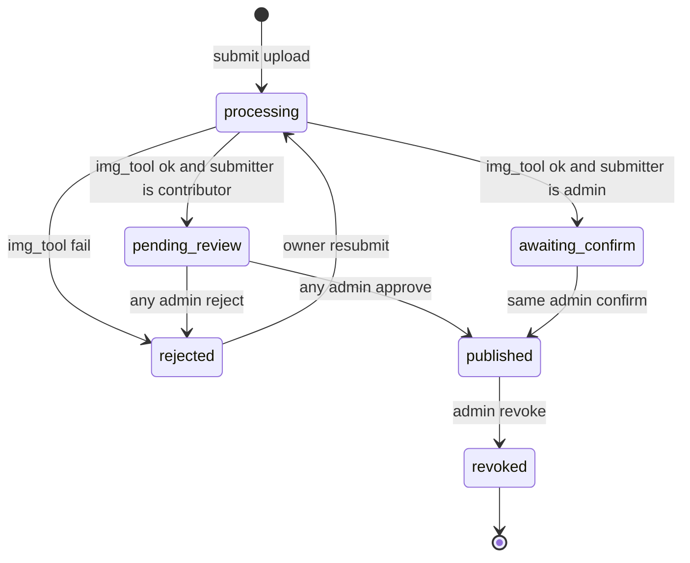
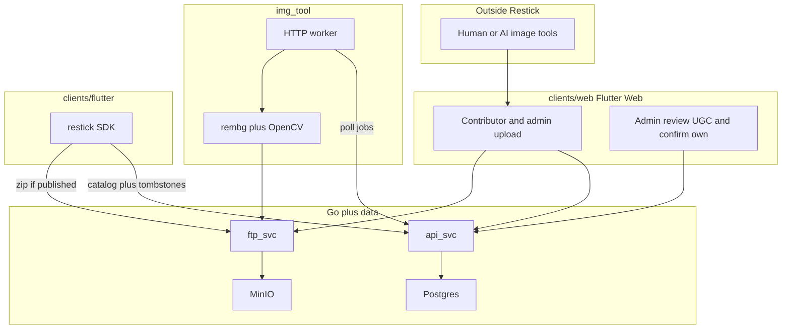
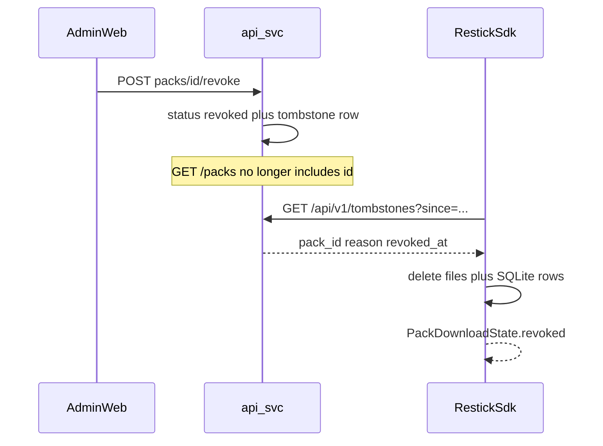
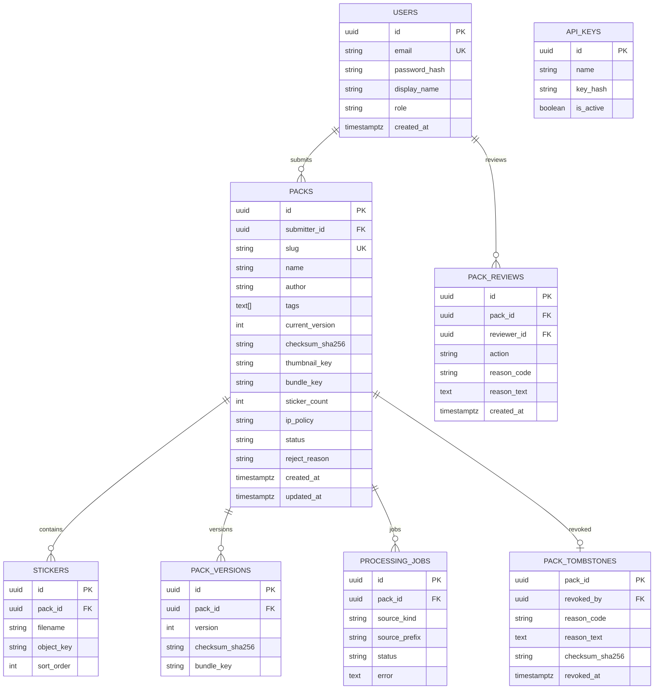

# Phase 00 — Decisions, architecture, risks

Date: 2026-08-20
Priority: P0
Status: pending approval
Updated: 2026-08-20 — DDD + lint mandatory; no automated tests (manual checklist)

## Context links

- Idea: [../../ideas/2026-08-20-sticker-pack-ecosystem.md](../../ideas/2026-08-20-sticker-pack-ecosystem.md)
- QA: [manual-test-checklist.md](./manual-test-checklist.md)

## Overview

Lock boundaries. Restick is a **process + moderate + serve** system. It does not generate stickers from keywords.

## Tech stack (MVP)

| Layer | Choice |
| --- | --- |
| Catalog / auth / jobs | Go `api_svc` + **PostgreSQL 16** |
| Object storage | Go `ftp_svc` + **MinIO** |
| Image pipeline | Python `img_tool` (CLI + HTTP worker) |
| Admin + contributor UI | **Flutter Web** `clients/web` (one app, RBAC) |
| Mobile consume | Flutter package `clients/flutter/restick` |
| Compose | postgres, minio, ftp_svc, api_svc, img_tool worker, optional web nginx |

Rejected: keyword gen APIs, Redis (poll Postgres jobs), separate admin SPA, RFC 959 FTP, SAM-by-default, automated test suites. Public Flutter/web stay HTTP; **services speak gRPC to each other**.

## Engineering standards (all modules)

Applies to `ftp_svc`, `api_svc`, `img_tool`, `clients/web`, `clients/flutter`. No exceptions for “small” services.

### DDD layers

Dependency direction: `interfaces` → `application` → `domain` ← `infrastructure`. Domain never imports the other three.

| Layer | Contains | Must not contain |
| --- | --- | --- |
| `domain` | Aggregates, entities, VOs, domain errors, **repository ports** | SQL, JSON tags for transport, MinIO, rembg, widgets |
| `application` | Use cases (submit, confirm, revoke, process sheet, sync tombstones) | `net/http`, `pgx`, Flutter widgets |
| `infrastructure` | Postgres, MinIO, rembg/OpenCV, `http` clients, Drift | Business rules (status transitions live in domain) |
| `interfaces` | HTTP handlers, CLI, worker loop, Flutter screens | SQL queries, cutout math |

Go layout (both services):

```
cmd/<svc>/main.go
internal/domain/<aggregate>/
internal/application/<usecase>/
internal/infrastructure/persistence/   # or objectstore/
internal/interfaces/http/
```

Python `img_tool`: `domain/`, `application/`, `infrastructure/`, `interfaces/cli.py` + `interfaces/worker.py`.

Flutter (SDK + web): `lib/src/domain/`, `lib/src/application/`, `lib/src/infrastructure/`, `lib/src/presentation/` (UI is the interface adapter). One export still `lib/restick.dart` for the package.

### Lint (definition of done)

| Codebase | Must pass | Config committed in-module |
| --- | --- | --- |
| Go (`ftp_svc`, `api_svc`) | `gofmt` + `golangci-lint run` | `.golangci.yml` (same rules both services) |
| Python (`img_tool`) | `ruff check` + `ruff format --check` | `[tool.ruff]` in `pyproject.toml` |
| Dart (`clients/flutter`, `clients/web`) | `dart analyze` with `flutter_lints`, typed APIs, no `dynamic` | `analysis_options.yaml` (`strict-casts`, `strict-raw-types`) |

No `//nolint` / `ignore:` without a one-line reason on the same line. Implementer writes lint-clean code; đồng chí runs the linters (agents do not run `flutter analyze`).

### Tests

**Do not add** `*_test.go`, `tests/`, `test/`, pytest, widget tests, golden tests, mock generators.

**Do** execute and tick [manual-test-checklist.md](./manual-test-checklist.md) after each phase.

## Recommended defaults

| Topic | Choice | Why |
| --- | --- | --- |
| Core goal | Process uploads → review → serve SDK | Đồng chí: no gen, community + admin |
| Scale | Local Compose MVP | YAGNI |
| Stickers | Static WebP 512×512 | WA/TG size |
| Auth web | Email + password, JWT, roles `contributor` / `admin` | One app, phân quyền |
| Auth SDK | `X-Api-Key` (host app, machine) | Host apps are not people |
| Pipeline auth | `X-Internal-Token` | img_tool worker |
| IP | Human admin review + `ip_policy` | Code cannot see Disney |
| `ftp_svc` | HTTP gateway over MinIO | Name is historical |

## Pack lifecycle



**Admin ⊇ contributor on one account.** Admin uses the same upload/my-packs screens. Do not require a second user.

| Status | In SDK list | Who acts |
| --- | --- | --- |
| `processing` | no | worker |
| `pending_review` | no | **other** community packs; any admin approve/reject in queue |
| `awaiting_confirm` | no | **submitter admin only** — preview + Confirm; not a second-account review |
| `rejected` | no | owner resubmit |
| `published` | yes | serve |
| `revoked` | no; tombstones | any admin |

Confirm is a required click after seeing processed stickers. Not silent auto-publish. Not a review by a different persona.

**Approve** = may be served. **Revoke** = leave serve list + insert tombstone + SDK must delete local bytes. **Reject** = never served; no tombstone (never on devices). Hard-delete of MinIO objects is optional after revoke; tombstone row is **kept** so late clients still purge.

## Architecture



## Module contracts

| Module | Owns | Must not own |
| --- | --- | --- |
| `img_tool` | Cutout, WebP, `pack.json`, worker job runner | Users, approve/revoke, keyword gen |
| `ftp_svc` | Objects, bundles, upload prefix `uploads/` | Search, roles, tombstones |
| `api_svc` | Users, JWT, packs, jobs, reviews, tombstones, API keys | File bytes, zip assembly, image ML |
| `clients/web` | Upload, my packs, review queue, revoke UI | Cutout, serving binaries |
| `clients/flutter` | Cache, picker, **purge on tombstone** | Moderation |

**Forbidden in every module:** text-to-image, prompt fields, “generate pack from keyword.”

## Data flow (community submit)

1. Contributor logs into `clients/web`, creates pack draft (name, tags, author display).
2. Browser PUTs sheet (or N images) to `ftp_svc` under `uploads/{user_id}/{pack_id}/` with JWT.
3. `POST /api/v1/packs/{id}/submit` → pack `processing`, job `queued`.
4. Worker writes WebPs + bundle. If submitter is `contributor` → `pending_review`. If submitter is `admin` → `awaiting_confirm`.
5. Community: another admin (or the same admin acting as moderator) approves/rejects in the queue.
6. Admin’s own pack: same login, pack detail shows processed preview + **Confirm publish**. No account switch.
7. SDK lists only `published`.

## Data flow (revoke + purge)



SDK **must** call tombstones on startup and before showing the picker. Host app must not keep a revoked `File` path.

## Domain model



`reason_code`: `copyright` | `community_guidelines` | `quality` | `other`.  
`source_kind`: `sheet` | `files`.  
`role`: `contributor` | `admin`. Admin **is** a contributor: same upload, submit, my-packs APIs. Extra: review queue, confirm own packs, revoke. One login.

## Trade-offs

- **Flutter Web vs React admin:** Flutter Web locked — one language with the SDK, one app two roles. Heavier first paint; acceptable for internal+community MVP.
- **Multipart through api_svc vs direct PUT to ftp_svc:** Direct PUT with JWT on `uploads/` prefix. api_svc never holds sticker bytes on the serve path.
- **CLI internal token:** still `pending_review` (no person). An admin confirms in Web UI, or uses JWT confirm — CLI must not silently publish.
- **Admin confirm vs approve:** confirm = owner admin after seeing cutouts. Approve = moderating someone else’s `pending_review`. Same published result, different actor rules.
- **Delete MinIO on revoke:** Tombstone first; garbage-collect objects later. Late clients still need the id in tombstones.

## Risks

| Risk | Impact | Mitigation |
| --- | --- | --- |
| UGC copyright / thuần phong | Legal, brand | Admin review required; revoke+purge |
| Contributor thinks app “AIs” a pack | Scope creep | No prompt UI; copy says “upload images only” |
| Contour quality | Bad packs in queue | Admin sees previews; reject `quality` |
| Devices keep revoked packs | Policy fail | Tombstone sync is P0 in SDK, not phase 8 |
| Job worker down | Stuck `processing` | Job timeout + retry; UI shows error |
| No unit tests | Regressions | Phase-gated [manual-test-checklist.md](./manual-test-checklist.md); lint as gate |

## Security (v1)

- Passwords: bcrypt. JWT HS256, short access TTL + refresh cookie for web (SameSite, HTTPS in prod).
- CORS allowlist = Web UI origin only. SDK uses API key, no CORS need on mobile.
- Roles enforced on every write. Contributor can only mutate own non-published packs.
- Revoke/approve: `admin` only.
- `X-Internal-Token` for worker; never in the browser.
- Image magic-byte check on `ftp_svc` PUT.
- Register: email+password; rate-limit. Seed `BOOTSTRAP_ADMIN_EMAIL` / `BOOTSTRAP_ADMIN_PASSWORD`.

## Unresolved (non-blocking)

1. Author string: submitter display name vs custom pack author field? (Default: both; `author` editable.)
2. Telegram/WhatsApp zip layout vs Restick `pack.json` only? (Default: Restick only.)
3. Public self-register vs invite-only contributors? (Default: **open register** as contributor; first user from env is admin.)
4. After revoke, hide pack from submitter or show “revoked”? (Default: submitter sees revoked + reason.)
