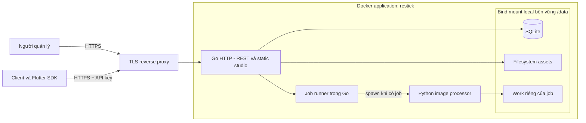

# Restick Sticker Factory — spec nghiệp vụ và kiến trúc một người quản lý

Ngày: 2026-11-10. Trạng thái: **đã được người dùng duyệt để triển khai trong worktree cách ly; chưa cho phép merge, push, deploy hoặc xóa dữ liệu cũ**.

## 1. Ý định và quyết định

### Đã được người dùng xác nhận

- Một người quản lý; không contributor, đăng ký công khai, gửi duyệt hay kiểm duyệt.
- Một ảnh lớn chứa nhiều sticker được tạo bằng AI **bên ngoài Restick**.
- Studio ghép những mảnh ý tưởng tái sử dụng thành prompt để copy; nhận ảnh trở lại, cắt và tạo viền.
- Thư viện rộng, đa dạng, mở rộng được: màu sắc, nhân vật tham chiếu, phụ kiện, đất nước/văn hóa và các trục sáng tạo khác.
- Client dùng API key để lấy tài nguyên và sử dụng; không có quyền quản lý.
- **SQLite + filesystem**, không PostgreSQL, không MinIO trong kiến trúc mục tiêu.
- Triển khai trên **một VPS bằng Docker**.

### Lựa chọn của người thiết kế, cần duyệt trong spec này

- Giữ Go làm backend; tái sử dụng Python/Pillow/OpenCV cho xử lý ảnh theo tác vụ.
- Một application container, một HTTP origin, REST; không GraphQL hay gRPC nội bộ.
- Next.js/React hiện có chuyển sang static export, Go phục vụ file đã build; không Node server ở runtime.
- Một job xử lý ảnh hoạt động tại một thời điểm; hàng đợi và trạng thái bền vững trong SQLite.
- Bộ sticker hợp lệ tự trở thành sẵn sàng cho client sau xử lý, không có bước publish/approve thủ công.
- Giữ giao thức đọc và gói tải của Flutter SDK; bỏ các API ghi dành cho contributor/reviewer.
- Khởi tạo vào thư mục dữ liệu **mới**, không chuyển dữ liệu PostgreSQL/MinIO cũ tự động. Không xóa hoặc ghi lại volume cũ. Chuyển dữ liệu cũ, nếu cần, phải bổ sung phạm vi trước khi duyệt kế hoạch; không được âm thầm reset.

Spec là một dự án tích hợp: thư viện → prompt → ảnh → pack → client. Không giao các phần rời rạc mà không có luồng sử dụng hoàn chỉnh.

## 2. Mục tiêu, không làm và điều không được xảy ra

**Mục tiêu:** giảm dịch vụ thường trực; giữ khả năng sáng tạo; một người vận hành được; ảnh/tác vụ/danh mục còn nguyên khi restart; không phát file chưa hoàn chỉnh; client hiện có tiếp tục đọc và tải pack.

**Không làm:** tạo ảnh trong Restick; tích hợp billing/AI provider; marketplace cộng đồng; đăng ký nhiều người; kiểm duyệt; animation/video; sửa ảnh bằng trình vẽ/crop thủ công trong studio; LLM/vector database/GPU thường trực; multi-node/HA; migration dữ liệu cũ tự động; đổi Flutter public API chỉ để đổi backend.

**Anti-goals:** ép mọi chủ đề vào vài preset đóng; ngẫu nhiên hóa làm mất nhận diện; hứa AI tuân thủ đúng lưới; gọi viền phục hồi mask hiện tại là công cụ viền đã hoàn chỉnh; để API key client ghi; file SQLite lộ qua web; mất tài nguyên khi recreate container.

## 3. Các phương án đã xét

| Phương án | Lợi ích | Đánh đổi | Quyết định đề xuất |
| --- | --- | --- | --- |
| Go + Python theo tác vụ, một app container | Tận dụng HTTP/SDK và xử lý ảnh hiện có; không thêm backend server | Image chứa cả Go binary và Python runtime | **Chọn** |
| Viết lại backend bằng Python | Một ngôn ngữ server-side | Viết lại HTTP/auth/catalog, ít giá trị trực tiếp cho nhu cầu hiện tại | Không chọn |
| Hai container Go và worker thường trực | Tách giới hạn tài nguyên hai tiến trình | Thêm giao thức, triển khai và vòng đời worker | Không cần ở quy mô này |

Database đã chốt, không mở lại lựa chọn engine: [nghiên cứu database](../research/lightweight-databases.md). REST đủ cho catalog và binary HTTP; GraphQL không giảm số runtime cần chạy.

## 4. Kiến trúc triển khai



- Container `restick`: Go PID 1; Python là child process có timeout, không service HTTP/worker polling riêng. `init: true` xử lý thu gom child process; Go vẫn chịu trách nhiệm cancel và chờ process.
- Giữ TLS ở reverse proxy VPS đang có. Compose ứng dụng chỉ bind `127.0.0.1:8080:8080`; không tự thêm gateway nội bộ, database hoặc object-store container. Nếu VPS chưa có proxy/TLS, đó là prerequisite phải cấu hình trước khi mở public, không chạy HTTP công khai với mật khẩu/API key.
- Multi-stage build: Node build web, Go build backend, Python slim runtime có Pillow/NumPy/OpenCV-headless. Không dùng scratch/distroless chỉ chứa Go cho image cần Python/native libraries.
- Không có Node, PostgreSQL, MinIO, Redis, gRPC hoặc daemon xử lý ảnh thường trực ở runtime.
- `./data:/data` trên filesystem local của VPS, không NFS. Một instance ghi; không scale replicas bằng cách chia sẻ file DB.
- Không đặt target RAM/CPU quảng cáo khi chưa benchmark; giới hạn upload và một child xử lý ảnh giúp giới hạn tải, không bảo đảm một mức RAM cụ thể.

## 5. Nghiệp vụ Studio

### 5.1 Thư viện mảnh ghép

- Mỗi nhóm có ID ổn định, tên Việt, mô tả, thứ tự. Người quản lý thêm/sửa nhóm riêng; xóa nhóm còn mảnh trả `409 group_not_empty`.
- Mỗi mảnh có ID, nhóm, tên Việt, mô tả prompt tiếng Anh, ghi chú/nguồn tùy chọn, phạm vi `identity|pack|sticker`, trạng thái archived. Có thể tìm theo tên Việt/Anh và lọc nhóm/phạm vi.
- Giá trị seed: **425 mảnh thị giác + 329 mảnh ngữ cảnh**, cùng **24 palette** có vai trò màu/mã sRGB; lấy từ [bộ nghiên cứu](../research/sticker-factory/README.md). Các mục là nội dung biên soạn, không nhập toàn bộ bản ghi Getty/Unicode/UNESCO hoặc ảnh bên ngoài.
- Seed là JSON canonical `restick.seed.v1` được biên soạn và kiểm tra từ dossier, không parse Markdown trong runtime. Mảnh thị giác dùng ID `v-d01-001` theo chiều/thứ tự tại lần biên soạn đầu; mảnh ngữ cảnh dùng `c-` cộng mã tài liệu nguyên vẹn; palette dùng `p-001`…`p-024`. Gán scope và prompt English theo ý nghĩa, bổ sung mô tả cho dòng chưa có; không đưa ghi chú cảnh báo vào prompt. Sau khi gán, ID không đổi dù reorder; init một lần và không ghi đè chỉnh sửa khi restart.
- Không ép một quốc gia đi kèm tính cách/trang phục; không biến cảnh báo văn hóa/quyền thành bộ kiểm duyệt tự động.
- Palette lưu riêng như một mảnh có `colors` với bốn vai trò `primary,secondary,accent,line`; mỗi vai trò là `#RRGGBB`. Mảnh khác không cần có `colors`.

### 5.2 Hồ sơ nhân vật và tham chiếu

- Tên, mô tả nhận diện cần giữ, ảnh tham chiếu tùy chọn và ghi chú quyền sử dụng.
- Ảnh tham chiếu chỉ quản trị viên đọc được; không tự tải URL bên ngoài và không tự gửi cho AI. UI nhắc phải đính kèm ảnh bằng tay ở công cụ AI nếu muốn dùng reference.
- Có thể đổi chủ đề/phụ kiện/màu nhấn nhưng giữ các đặc điểm đã chọn. Không bảo đảm mô hình ảnh tái tạo danh tính tuyệt đối.

### 5.3 Bàn ghép và bản thiết kế bộ

- Chọn nhân vật tùy chọn, mảnh chung của bộ, palette tùy chọn và nội dung từng sticker. Mỗi sticker có hành động/biểu cảm mô tả được; mảnh theo sticker không tự thay nhận diện chung.
- Người quản lý thêm text tự do vào từng phần. Nhóm tự tạo không cần sửa code.
- Giữ/unlock mảnh đã chọn. Hành động “Gợi ý lại” chỉ lấy mẫu từ các nhóm đang tham gia và thay lựa chọn chưa giữ; không tự thêm mọi nhóm, không gọi AI và không ghi đè text tự do hoặc nội dung từng ô.
- Một lựa chọn chủ đạo cho mỗi nhóm đang tham gia; tổ hợp có chủ ý dùng text tự do để bổ sung, không dựng rule engine/plugin cho quan hệ nghệ thuật.
- Lưu thiết kế gồm lựa chọn + snapshot mô tả + text tự do + danh sách ô + prompt hoàn chỉnh. Sửa/archive thư viện sau đó không làm prompt lịch sử đổi. Có thể sửa thiết kế thành snapshot mới khi bấm lưu; không tạo version history không giới hạn.
- Prompt là mô tả có quan hệ theo thứ tự: nhận diện → chủ đề → phong cách/màu/đạo cụ/văn hóa → từng ô → chỉ dẫn kỹ thuật. Bản mặc định tiếng Anh; nhãn UI tiếng Việt, không coi bản dịch là một mảnh mới.
- Rows/columns là số nguyên 1–8, tổng ô không quá 64, số mô tả ô phải bằng rows × columns. Đây là giới hạn đề xuất của bản thiết kế, không phải quy luật AI.
- Cỡ viền mặc định **4 px ở ảnh xuất 512**, cho phép 0–16 px; màu mặc định `#FFFFFF`, có thể đổi `#RRGGBB`. 0 nghĩa là không thêm viền. Lưu thông số trong thiết kế và job snapshot.
- Chỉ dẫn đầu ra mặc định: nền trắng phẳng, không grid lines/numbering/watermark/caption, không background shadow, đủ khoảng cách và toàn bộ hình không bị cắt. Chủ đề thời tiết/đất nước không đồng nghĩa cần nền cảnh đầy sheet.
- Copy prompt dùng clipboard và có cách chọn văn bản thủ công khi trình duyệt không cấp clipboard. Không giả nút “tạo ảnh” trong Restick.

### 5.4 Nhập ảnh và tự tạo pack

- Tạo pack với tên, slug duy nhất, author, mô tả/tags và thiết kế đã lưu; thay đổi thiết kế không tự xử lý lại ảnh cũ. Slug được giữ duy nhất kể cả sau revoke; pack ID mới cần slug mới, không tái sử dụng URL/định danh cũ.
- Upload **một sheet** PNG/JPEG/WebP, tối đa **8 MiB**, ảnh decode được, mỗi cạnh tối đa **4096 px**. Không nhận ZIP đầu vào, SVG, animation hoặc ảnh qua URL.
- File tham chiếu áp dụng cùng giới hạn ảnh và là tài nguyên private, không tự sinh job.
- Upload hoàn tất và persist source trước khi enqueue. `POST process` snapshot thiết kế/viền/source, trả `202` cùng job ID; một pack không có hai job active (`queued|running`), lần thứ hai trả `409 job_active`.
- Quản trị viên xem tiến độ bằng trạng thái/polling, đóng trang không hủy job. Không thêm WebSocket chỉ để cập nhật trạng thái.
- Job thành công qua kiểm tra kỹ thuật thì pack tự `ready`. Không có submit, confirm, approve, reject hoặc publish bằng tay.
- Kết quả sai số lượng/cụm dính/mất chi tiết: báo lỗi có lý do; người quản lý sửa/tạo lại ở AI bên ngoài rồi upload lại. Không bỏ qua lỗi, không xuất tập con và gọi là thành công.
- Sửa name/description/tags là sửa metadata catalog trong SQLite, không đổi bytes version. `pack.json` giữ toàn bộ field `restick.pack.v1` hiện có như **snapshot ở thời điểm tạo version**, nên tên/tags trong bundle cũ có thể khác catalog mới và đó là hành vi chủ ý. Muốn cập nhật manifest phải tạo version mới; không bỏ field schema cũ hoặc sửa ZIP đã commit. Sửa source/viền/nội dung manifest thuộc version tài nguyên mới.

## 6. Trạng thái và xử lý lỗi

**Pack:** `draft → ready → revoked`; từ draft có thể xóa. `revoked` kết thúc vòng đời ID đó; muốn phân phối lại thì tạo pack ID mới để không xung đột tombstone SDK.

**Job:** `queued → running → succeeded|failed|interrupted`. Tiến độ xử lý không là trạng thái kiểm duyệt và không thay `ready` của version đang phục vụ.
- **Revoke thắng job:** trong transaction revoke, ghi tombstone một lần và đổi mọi job queued/running của pack sang interrupted với `pack_revoked`; cancel child nếu đang chạy. Completion chỉ commit nếu job vẫn running và pack chưa revoked trong cùng transaction. Kết quả đến muộn không khôi phục ready; version đã cấp không tái dùng, file chưa commit trở thành orphan không public. Pack draft có active job không được DELETE/revoke; cancel bằng shutdown hoặc đợi job kết thúc, không thêm endpoint cancel ở scope này.

- Nếu tạo version mới thất bại, version cũ vẫn tải được; nếu pack chưa có version thì giữ draft và hiển thị lỗi job.
- `failed`: lỗi input/cắt/viền/đóng gói/timeout; không tự retry. Người quản lý bấm xử lý lại tạo job mới với version mới được cấp.
- Startup chuyển job `running` của lần chạy trước thành `interrupted`, không để kẹt; job `queued` vẫn được nhận. Không coi process chết là bằng chứng hoàn tất.
- Go bắt SIGTERM, ngừng nhận job mới, cancel/chờ child, giữ trạng thái nhất quán. Nếu bị SIGKILL, startup recovery xử lý.
- Timeout mặc định **300 giây**, cấu hình `RESTICK_PROCESS_TIMEOUT`; lỗi timeout không làm mất pack đang ready.
- Theo giao thức, Python chỉ đọc source và ghi work của job, không mở SQLite hoặc sửa committed version. **Đây không phải sandbox/ACL theo UID:** Go và Python cùng UID 10001 nên OS vẫn cho child quyền filesystem tương tự. Chỉ chạy code processor đóng gói sẵn, không plugin/script người dùng; validate input/output/path và container mount là lớp bảo vệ. Nếu cần cách ly decoder khỏi quyền dữ liệu bằng OS thì phải đổi thiết kế, không tuyên bố đã có.

## 7. Pipeline xử lý và giao thức Go–Python

### 7.1 Giao thức local, không mạng

Go chạy argv cố định, không shell: `python -m img_tool.interfaces.machine_job --request <request-path> --result <result-path>`. Hai đường dẫn do server tạo trong thư mục job, không nhận executable/argv từ HTTP.

- Request JSON `schema=restick.job.v1`: `job_id,pack_id,version,sheet_path,output_dir,rows,columns,outline_width,outline_color`.
- Result JSON `schema=restick.job-result.v1`: thành công có danh sách sticker theo ô với filename/thumb/width/height và diagnostics; lỗi có `code,message`. Exit code khác 0 không được coi thành công dù có file result cũ.
- Go validate schema, job/pack/version và đường dẫn output; giới hạn JSON result **1 MiB**. Stderr chỉ diagnostics có giới hạn giữ trong lỗi job, không chứa secret.
- `sheet_path` nằm trong source đã nhận, `output_dir` nằm trong work của job; Python không tự chọn UUID hoặc version. Chỉ trả đường dẫn tương đối đã chuẩn hóa, không symlink/traversal.

### 7.2 Xử lý ảnh

- Giữ các thuật toán hữu ích ở `cutout.py`, `layout.py`, `webp_export.py`; dùng alpha thật hoặc simple gần trắng hiện có. Không cài rembg/model neural vào image mặc định.
- Alpha đầu vào phải được kiểm tra có foreground/background hữu ích, không chỉ dựa vào tên PNG hoặc ô bàn cờ giả. Với simple, ghi rõ nền gần trắng; các style mảnh/glow/bán trong suốt có thể thất bại và cần thử lại.
- Contour/grouping tạo candidate boxes. Dùng tâm box xác định ô theo rows/columns; mỗi ô đúng một candidate, tổng đúng rows × columns. Không chỉ sort theo `(top,left)` rồi gán nội dung khi sheet lệch. Không tự kéo/di chuyển hình để che lỗi bố cục.
- Các chủ thể chạm nhau trong **cùng sticker** có thể là một cụm hợp lệ; các sticker khác ô không được dính nhau. Thuật toán không tuyên bố hiểu nội dung/nhân vật; lỗi kỹ thuật nhận diện được phải fail rõ ràng.
- Tách nền trước, fit vào vùng an toàn, tạo viền ngoài từ alpha, composite đúng alpha. Chừa viền + **4 px khoảng trống** trong canvas để không clipping; không dilate màu foreground thành viền.
- Xuất sticker **512×512 WebP lossless**, thumbnail **128×128**, `thumb.webp` pack lấy thumbnail sticker đầu. Giữ alpha và màu không bị fringe do nhân alpha hai lần.
- Bảo toàn thứ tự ô row-major. Chữ, phụ kiện rời, style khó không bị cấm trong thư viện; đầu ra không đạt điều kiện kỹ thuật thì báo lỗi, không hứa mọi style đi qua đường nhanh.

## 8. Lưu trữ, phiên bản và commit file

### 8.1 Bố trí dữ liệu

```text
/data/
  restick.sqlite
  sources/{asset-id}/original.{ext}
  work/{job-id}/request.json, result.json, output/
  packs/{pack-id}/v{version}/pack.json, thumb.webp, 000.webp, thumbs/...
  bundles/{pack-id}/v{version}.zip
```

Source và work không được mount vào static web root. Database/WAL/SHM ở cùng mount local. Thư mục backup nằm **ngoài** cây tài nguyên HTTP.

### 8.2 SQLite

- Driver đề xuất `modernc.org/sqlite v1.62.0`, yêu cầu **Go 1.26.0** theo go.mod của driver; nâng toolchain backend/build từ 1.25 theo phụ thuộc này, không dùng @latest. Không thêm ORM. Nguồn: https://gitlab.com/cznic/sqlite/-/raw/v1.62.0/go.mod.
- `foreign_keys=ON`, `journal_mode=WAL`, `synchronous=FULL`, `busy_timeout=5000 ms`; pool backend **một connection** để serialize transaction ngắn. Không giữ transaction trong lúc chạy Python/stream ZIP.
- Schema migrations có số phiên bản, mỗi migration transactional khi SQLite cho phép. Không startup reset/drop DB và không dùng `CREATE TABLE IF NOT EXISTS` thay cho theo dõi schema version.
- Tables: `owner` singleton, `admin_sessions`, `fragment_groups`, `fragments`, `characters`, `reference_assets`, `designs`, `packs`, `pack_tags`, `pack_versions`, `stickers`, `processing_jobs`, `api_keys`, `pack_tombstones`, `schema_migrations`, `seed_versions`.
- JSON snapshot ở designs/jobs là dữ liệu ứng dụng có `schema_version=1`, không nhập nguyên văn Markdown. Quan hệ catalog/tag/version và unique slug có constraint/index; FK phải bật trên connection.
- `pack_versions` giữ metadata đã commit của từng version; `stickers` khóa `(pack_id,version,sort_order)`. Version được cấp tăng trong transaction enqueue và không tái dùng sau job fail.
- Một partial unique index bảo vệ một active job/pack, không chỉ kiểm ở HTTP.

### 8.3 Không giả vờ SQLite và filesystem là một transaction

1. Python ghi work output; Go kiểm tra file/count/dimensions/path và tạo `pack.json`, checksum, ZIP hoàn chỉnh trong work trên cùng volume.
2. ZIP ghi streaming ra disk, không gom toàn bộ ZIP vào Go RAM; tối đa **32 MiB**. Các member path cố định, duy nhất; không `..`, absolute path hoặc symlink.
3. Đóng/flush các file, fsync cần thiết; rename version output và ZIP sang đường dẫn cuối trên cùng filesystem. Chưa có DB reference nên chưa public.
4. Transaction SQLite kiểm job vẫn running/pack chưa revoked rồi commit version/stickers, current pointer và job succeeded. Chỉ sau commit mới xuất hiện qua API; revoke thắng làm completion thất bại mà không đổi pointer.
5. Crash trước commit: có thể còn orphan files, nhưng không public. Startup đối chiếu work/job/DB, giữ chẩn đoán của job interrupted và không tự xóa version đã commit.
6. Nếu commit DB thất bại, job báo failed/interrupted và pointer cũ giữ nguyên. Cleanup orphan chỉ được đụng đường dẫn không được bất kỳ committed version nào tham chiếu.

## 9. API và tương thích client

### 9.1 API đọc giữ nguyên contract SDK

Client cần `X-Api-Key` hợp lệ. **GET/HEAD tài nguyên `/v1/objects` và `/v1/bundles` cũng chấp nhận cookie session admin hợp lệ**, để ``/download same-origin của studio hoạt động mà không nhét key vào URL. Mỗi request kiểm session/key và trạng thái committed/revoked trước range/304. API key không cấp quyền ghi; endpoint `/api/v1/admin` chỉ chấp nhận session. Metadata client có thể dùng session owner với cùng visibility ready; preview private/draft dùng admin endpoint riêng.

| API | Kết quả |
| --- | --- |
| `GET /api/v1/packs?tag=&page=&page_size=` | Chỉ ready; `{items,page,page_size,total}`; page≥1, size mặc định 20, tối đa 100; thứ tự ổn định updated_at rồi id |
| `GET /api/v1/packs/{id}` | Summary fields hiện có và stickers; draft/không tồn tại 404, revoked 410 `pack_revoked` |
| `HEAD /api/v1/packs/{id}` | Cùng visibility, ETag checksum của pack |
| `GET /api/v1/packs/{id}/bundle` | `{url,checksum_sha256,version}` |
| `GET /api/v1/tombstones?since=` | `{items:[{pack_id,revoked_at,reason_code,checksum_sha256}]}` |
| `GET/HEAD /v1/objects/{key...}` | File thuộc committed version của pack ready; không generic file browser |
| `GET/HEAD /v1/bundles/{id}/v/{version}` | ZIP committed; kiểm tra trạng thái pack và key **trước** conditional cache/304 |

- Summary giữ `id,slug,name,author,tags,sticker_count,version,thumbnail_url,checksum_sha256`; Flutter không phải đổi hàm public vì backend đổi storage.
- `pack.json` giữ `schema=restick.pack.v1`. SHA256 là hash nối **bytes sticker WebP theo thứ tự manifest**, không phải hash file ZIP. ZIP có `pack.json`, `thumb.webp`, `000.webp...`, `thumbs/thumb_000.webp...`; đường dẫn `thumb` trong manifest tương ứng thực tế.
- Metadata private/no-store. File version immutable có ETag và range support, dùng `Cache-Control: private, no-cache` để revalidate qua auth; không public shared cache bỏ qua key/revoke.
- Không dùng API key trong query string/URL, không ghi raw key vào log. Cập nhật web/SDK chỗ dùng query key nếu có; browser admin dùng cookie.
- `since` dùng RFC3339 UTC, cố định precision giây như contract hiện có; query **inclusive >= since** và thứ tự `(revoked_at,id)`; lặp record hợp lệ vì SDK purge idempotent. Không phân trang tombstone ở lần cutover để không bỏ mất record cùng mốc thời gian. Invalid since trả 400, không âm thầm full sync.
- Mọi committed version còn retained của pack ready vẫn tải được để không làm hỏng client đang tải URL version cũ. Pack revoke chặn **tất cả** version và tạo tombstone trong cùng DB transaction. Không thể thu hồi bytes đã tải offline hoặc đã stream xong; SDK purge khi sync được, không hứa xóa tức thời mọi thiết bị.
- SDK tải ZIP phải validate member path/manifest trước ghi disk; lỗi checksum hoặc archive độc hại không để dữ liệu ra ngoài thư mục đích.

### 9.2 API quản trị mới, không giữ alias cộng đồng

Prefix `/api/v1/admin`:

- `POST/GET/DELETE /session`: login, thông tin session, logout.
- `GET/POST /fragment-groups`; `PUT/DELETE /fragment-groups/{id}`.
- `GET/POST /fragments`; `PUT/DELETE /fragments/{id}` (DELETE archive).
- `GET/POST /characters`; `GET/PUT/DELETE /characters/{id}`.
- `POST /reference-assets`, `GET /reference-assets/{id}`: ảnh private.
- `GET/POST /designs`; `GET/PUT/DELETE /designs/{id}`; `POST /designs/compile` và `POST /designs/suggest` không lưu nếu chưa bấm lưu.
- `GET/POST /packs`; `GET/PUT/DELETE /packs/{id}`; `POST /packs/{id}/source`, `POST /packs/{id}/process`, `POST /packs/{id}/revoke`.
- `GET /jobs/{id}`; xử lý lại gọi process tạo job mới, không sửa trạng thái job cũ.
- `GET/POST /api-keys`, `POST /api-keys/{id}/rotate`, `DELETE /api-keys/{id}` (vô hiệu hóa).

DELETE pack chỉ cho draft không active job; ready phải revoke. Revoke lặp là idempotent, không tạo tombstone mới hoặc đổi timestamp; không hard delete file/version trong luồng này. Nhân vật/tham chiếu còn được draft dùng phải báo 409 hoặc giữ snapshot thay vì để dữ liệu hỏng; chi tiết FK/snapshot implementer giữ đúng invariant này.

JSON errors dùng `{error:{code,message}}`, không lộ path nội bộ/stack trace. Admin JSON body tối đa **1 MiB**; multipart body tối đa **8 MiB + 64 KiB**, riêng bytes file vẫn tối đa **8 MiB**. Các danh sách admin dùng `q,group_id,scope,page,page_size` khi có ý nghĩa, giới hạn như catalog.

## 10. Bảo mật một quản trị viên

- Không bỏ authentication vì chỉ có một người. Một owner username `admin`; password hash bcrypt trong SQLite. Init DB mới cần secret file `RESTICK_ADMIN_PASSWORD_FILE`, không password mặc định; plaintext không lưu DB/log.
- Session opaque 32 random bytes, lưu SHA256 token trong `admin_sessions`, hết hạn **24 giờ**. Cookie `__Host-restick_admin`, HttpOnly, Secure, SameSite=Strict, Path=/; không lưu bearer token quản trị trong localStorage.
- Unsafe admin requests kiểm tra Origin đúng `RESTICK_PUBLIC_BASE_URL`; JSON endpoints từ chối content type khác, upload multipart vẫn phải qua session + Origin. Missing Origin trên unsafe HTTP cũng từ chối; dùng CLI cho bảo trì offline.
- Login giới hạn **5 lần sai / 15 phút / địa chỉ nguồn**, bucket memory có TTL eviction. Mặc định không tin forwarded headers. `RESTICK_TRUSTED_PROXY_CIDRS` chỉ định peer proxy thực tế (Docker bridge gateway/host proxy khi cần), mặc định rỗng; chỉ đọc X-Forwarded-For khi immediate peer nằm trong allowlist và phân tích chuỗi từ phía proxy tin cậy. Không mặc định tin cả dải private/internet; base URL/cookie Secure không suy từ header tùy ý.
- `restick admin set-password --password-file ...` chạy khi app dừng hoặc bằng một maintenance instance giữ exclusive app lock; đổi hash và xóa sessions trong transaction. Logout xóa session server-side.
- API key client: sinh 32 random bytes, raw hiển thị một lần; DB chỉ hash SHA256, prefix, name, active, expiry tùy chọn. Không bắt buộc last_used write trên mọi lượt tải. Rotate vô hiệu hóa key cũ cùng transaction tạo key mới; key hết hạn/bị revoke không tải tiếp request mới.
- Auth áp dụng cả HEAD/range/304/file URL. Key client tới admin route không có session trả 401; mọi phương thức ghi không được key cấp quyền.
- Read/write filesystem dùng ID server cấp, allowlist DB version/member; không path traversal, symlink, directory listing, filesystem root endpoint hay lộ private originals.

## 11. Giao diện web và repo cutover

- Giữ Next.js/React/Tailwind/React Query, không thêm UI framework. UI mặc định tiếng Việt; giữ i18n nền có sẵn, không bắt sinh đủ ngôn ngữ cho mảnh người dùng nhập.
- Routes static: `/login`, `/factory`, `/library`, `/characters`, `/packs`, `/packs/new`, `/packs/detail?id=...`, `/keys`, `/api-docs`; root dẫn `/factory`. Các màn hình đọc ID bằng query có Suspense phù hợp static export.
- Đổi `next.config.ts` từ **standalone thực tế hiện tại** sang export; không mô tả repo đang static chỉ vì README cũ nói thế. Không để dynamic `[id]` bắt biết ID pack ở build time.
- Điều hướng/tải lại URL trực tiếp phải hoạt động qua Go static handler; URL `/api/*` hoặc `/v1/*` không tồn tại trả JSON/404, không fallback vào HTML.
- Tháo register/contributor/queue/rejection analytics/review dialogs; không giữ route hoặc nhãn deprecated. Xóa localStorage bearer cũ khi chuyển session.
- Giữ module `services/api`, tên Go module hiện tại, đổi entrypoint thành `cmd/restick`; tổ chức theo module nghiệp vụ nhỏ: storage, auth, studio, packs, jobs, assets, http. Không tự tạo framework hexagonal/interface một-method cho mọi struct.
- Gộp chức năng cần thiết của ftp vào backend rồi xóa runtime/module ftp; Python bỏ serve/worker/grpc clients, chỉ còn core processor và CLI local. Xóa proto/gen và công cụ gen-proto khi không còn caller; giữ OpenAPI là một source-of-truth trong `contracts/openapi/v1.yaml`.
- Xóa Compose/includes/Postgres/MinIO/gateway/web Node runtime cũ, cấu hình/secret/env không còn dùng, CI matrix cũ và tài liệu vận hành sai. Không xóa dữ liệu host hoặc volume; không `down -v`.

## 12. Docker, cấu hình và vận hành

Cấu hình runtime mục tiêu:

| Biến | Ý nghĩa / giá trị |
| --- | --- |
| `RESTICK_DATA_DIR` | `/data` mặc định, phải writable bởi UID/GID 10001 |
| `RESTICK_HTTP_ADDR` | `:8080` mặc định trong container |
| `RESTICK_PUBLIC_BASE_URL` | HTTPS origin public bắt buộc; nguồn tạo URL và kiểm tra Origin |
| `RESTICK_ADMIN_PASSWORD_FILE` | Secret bootstrap cho DB mới; không bắt buộc sau khi owner đã tồn tại |
| `RESTICK_TRUSTED_PROXY_CIDRS` | Rỗng mặc định; allowlist nguồn proxy thực tế để đọc client IP, không điều khiển quyền API |
| `RESTICK_PROCESS_TIMEOUT` | `300s` mặc định |

- Docker `USER 10001:10001`, root filesystem read-only; chỉ `/data` và tmpfs `/tmp` writable. Work của job ở `/data/work` để rename cùng filesystem, không xuất version từ tmpfs sang disk bằng giả định atomic rename.
- `restart: unless-stopped`, `init: true`, `stop_grace_period: 30s`, JSON log rotate `10m` × `3`; không Docker socket/capabilities thêm. Drop capabilities, no-new-privileges.
- `restick healthcheck` kiểm HTTP loopback, DB mở và data dir sẵn sàng; Compose healthcheck gọi binary có sẵn, không cài curl riêng chỉ để probe. Không expose private health diagnostics ra public.
- Volume/ownership lỗi phải fail trước nhận traffic, không chuyển sang memory DB/temp dir.
- TLS proxy cấu hình body limit ≥8 MiB cộng multipart overhead, upload/response timeout phù hợp; không buffer toàn ZIP vào RAM. Domain/certificates là cấu hình VPS, không hardcode trong repo.
- Version image pin bằng release tag/digest để rollback, không deploy `latest` không truy xuất được.
- `restick backup --output DIR`: offline, app phải dừng; DB và toàn bộ sources/packs/bundles được snapshot chung, không chép work tạm hoặc secret bootstrap. Chạy maintenance container cùng image/volume bằng Compose; kiểm tra app lock để từ chối backup đang có writer.
- `restick restore --input DIR --password-file FILE`: offline, app lock, chỉ data dir trống; validate schema, file paths, checksums và DB integrity. Mật khẩu quản trị mới bắt buộc; thay owner hash, xóa toàn bộ admin sessions và **vô hiệu hóa mọi API key đã restore** để không hồi sinh key từng bị rotate/revoke. Owner tạo key mới và cấu hình lại client sau restore. Checksum phát hiện hỏng, không xác thực nguồn backup; backup phải từ nơi tin cậy và được bảo vệ ngoài sản phẩm. Không overwrite dữ liệu hiện hữu; kiểm tra referenced files trước khi nhận traffic.
- Copy backup ra nơi ngoài VPS là trách nhiệm vận hành; không thêm cloud backup daemon vào sản phẩm. Không chạy prune/delete tự động lên ảnh nguồn/committed versions.

## 13. Tiêu chí nghiệm thu

- **AC01:** Chạy Docker chỉ có một app service; không kết nối PostgreSQL/MinIO/gRPC/Node server. Recreate giữ metadata và file.
- **AC02:** Một owner đăng nhập/logout/reset password; không đăng ký công khai. Key đọc không sửa được bất kỳ dữ liệu hay gọi admin upload/process.
- **AC03:** Seed đủ 754 mảnh +24 palette, mở rộng nhóm/mảnh được; sửa mảnh không đổi prompt snapshot; restart không ghi đè chỉnh sửa.
- **AC04:** Ghép/giữ/gợi ý lại/sửa text/copy/lưu prompt hoạt động; mảnh giữ và nội dung từng ô không bị gợi ý lại thay đổi.
- **AC05:** Upload sheet hợp lệ, chạy một Python child, tạo đúng số ô/viền/canvas/thumbnail; không cần approve; client tải được pack ready.
- **AC06:** File quá lớn, decode lỗi, sai lưới/count, timeout và process crash đều báo lỗi; không phát pack thiếu, không mất version cũ.
- **AC07:** Hai process requests cùng pack không tạo hai job active; restart không kẹt running; work/orphan không public.
- **AC08:** Flutter hiện có đọc summary/bundle/tombstones và verify SHA256 đúng; ZIP member traversal hoặc checksum sai không ghi file ngoài dest.
- **AC09:** Revoke làm mọi URL version trả 410 cho request mới; delta sync inclusive không bỏ tombstone cùng timestamp; offline limitation được mô tả đúng.
- **AC10:** File roots/originals/DB/backup, symlink/traversal và key trong URL không mở đường bỏ auth; HEAD/range/304 cũng kiểm quyền.
- **AC11:** Static studio reload các route mới được, không Next runtime/dynamic build-ID; luồng quản trị đầy đủ được kiểm trên trình duyệt.
- **AC12:** Offline backup/restore sang data dir mới khôi phục catalog và SDK tải/verify được; credential bootstrap không bị leak vào backup/log.
- **AC13:** OpenAPI/README/env/Compose/CI theo kiến trúc mới; không còn caller runtime của dịch vụ đã xóa; nguồn dữ liệu stack cũ không bị tác động.

## 14. Quyết định còn để implementer

Tên helper/private type nội bộ; tối ưu index sau query plan; bố cục UI theo house components; cách serialize selected snapshots khi giữ schema_version/invariants. Không thay driver/toolchain đã pin, endpoint client, trạng thái, giới hạn/timeout hoặc chính sách dữ liệu cũ mà không cập nhật spec và kế hoạch.

Chưa có benchmark tài nguyên hoặc ảnh từ AI cụ thể. Acceptance ảnh phải dùng fixture có thể tái tạo và một lượt người quản lý thử ảnh AI thực tế; không hứa độ chính xác/tốc độ không được đo. Nguồn nghiên cứu prompt, màu/văn hóa và giới hạn engine: [research dossier](../research/sticker-factory/README.md).

## 15. Builder check và bàn giao

Một builder độc lập đã đọc bản đầu và nêu bảy điểm cần quyết định. Bản này ghi rõ cách xử lý: manifest là snapshot; revoke thắng completion; cookie owner được đọc file same-origin; restore vô hiệu hóa credential cũ; child cùng UID không phải sandbox; seed canonical cần biên soạn; slug vẫn được giữ sau revoke. Đây là các quyết định của người thiết kế đưa ra để duyệt, không phải tuyên bố code đã thực hiện hoặc được kiểm thử.

Kế hoạch đi kèm: [12 task triển khai](../plans/2026-11-10-single-operator-sticker-factory.md). Chỉ bắt đầu implementation sau khi người dùng duyệt cả hai tài liệu và workspace. Những kế hoạch đa dịch vụ/cộng đồng cũ là lịch sử, không tự động được dùng làm yêu cầu cho kiến trúc mới sau khi bản này được duyệt.
