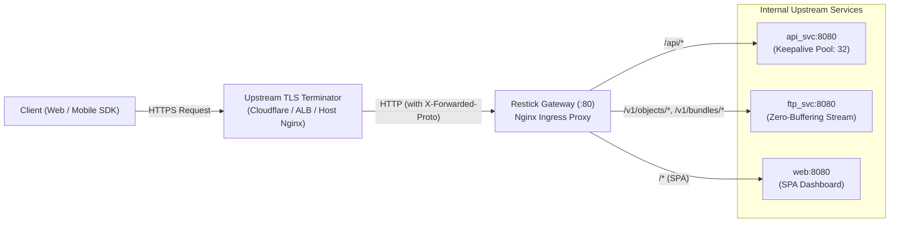

# Restick Ingress API Gateway

Production Nginx reverse proxy providing a unified entrypoint (**Single Ingress**) for the entire Restick platform.

---

## 📖 Overview

The **Gateway** service acts as the central traffic controller for Restick. By unifying all backend services (`api_svc`, `ftp_svc`, `web`) under a single domain and port:

1. **Eliminates Cross-Origin Complexity**: Clients (Web SPA, Mobile SDK, CLI) communicate with a single base URL (`https://restick.your-domain.com`), avoiding browser CORS preflight roundtrips.
2. **High-Throughput Streaming**: Zero-buffering reverse proxy configuration ensures multi-megabyte sticker packs and ZIP bundles stream directly from object storage to clients without consuming gateway memory.
3. **Security Boundary**: Blocks external access to internal cluster endpoints (`/internal/*`).
4. **Preserves Upstream TLS State**: Seamlessly handles SSL termination from upstream proxies (Cloudflare, AWS ALB, Host Nginx) by detecting and propagating `X-Forwarded-Proto`.

---

## 🧭 Routing Map

| External Path | Target Upstream | Method | Purpose / Behavior |
| :--- | :--- | :--- | :--- |
| `GET /healthz` | Direct Gateway Response | `GET` | Gateway liveness and readiness probe (Returns `200 OK`) |
| `/api/*` | `http://api_backend/api/*` | `ALL` | REST API: Authentication, user profiles, pack catalog, moderation, API keys |
| `/docs` | `http://api_backend/docs` | `GET` | Interactive Swagger UI API documentation |
| `/openapi.yaml` | `http://api_backend/openapi.yaml` | `GET` | Raw OpenAPI 3.0 specification file |
| `^/(v1/objects\|v1/bundles)/` | `http://ftp_backend` | `GET, PUT` | CDN & Asset streaming: WebP stickers and deterministic `.zip` archives (`proxy_buffering off`) |
| `/internal/*` | Direct Gateway Response | `ALL` | **Blocked: HTTP 403 Forbidden** (Protects inter-service cluster endpoints) |
| `/*` | `http://web_backend/` | `GET` | Flutter Web SPA Admin & Contributor dashboard (HTML5 History fallback) |

---

## ⚡ Architecture & Performance Optimizations



### 1. Zero-Buffering Asset Streaming
For `/v1/objects/*` and `/v1/bundles/*`, proxy buffering is explicitly disabled:
```nginx
proxy_buffering off;
proxy_request_buffering off;
proxy_max_temp_file_size 0;
```
- **Why**: Allows large `.zip` sticker bundles (up to 50MB) and raw sticker sheets to stream chunk-by-chunk between MinIO S3 and the client without being buffered onto disk or consuming Gateway RAM.

### 2. TLS Protocol Preservation (`$real_proto`)
When running behind a reverse proxy or CDN (e.g. Cloudflare, AWS ALB), Nginx detects the incoming `X-Forwarded-Proto` header:
```nginx
map $http_x_forwarded_proto $real_proto {
    default $scheme;
    "http"  http;
    "https" https;
}
```
All downstream proxy requests forward `proxy_set_header X-Forwarded-Proto $real_proto;`, ensuring generated asset links (e.g., in `public_origin.go`) always use the correct `https://` protocol.

### 3. Upstream Keepalive Pooling
Upstream blocks configure HTTP/1.1 persistent connections with `keepalive 32;` to eliminate TCP handshake overhead on high-frequency API calls.

### 4. Gzip Compression
Configured for text, JSON, CSS, JavaScript, and WebAssembly (`.wasm` for Flutter Web CanvasKit).

---

## 🔒 Production Deployment

### Option A: Running Behind Host Nginx (Recommended)

When hosting on a Linux VPS with Certbot / Let's Encrypt, configure the host Nginx to proxy traffic to the Docker Gateway on port 80:

```nginx
server {
    listen 80;
    server_name restick.your-domain.com;
    return 301 https://$host$request_uri;
}

server {
    listen 443 ssl http2;
    server_name restick.your-domain.com;

    ssl_certificate /etc/letsencrypt/live/restick.your-domain.com/fullchain.pem;
    ssl_certificate_key /etc/letsencrypt/live/restick.your-domain.com/privkey.pem;

    client_max_body_size 50M;

    location / {
        proxy_pass http://127.0.0.1:80;
        proxy_set_header Host $host;
        proxy_set_header X-Real-IP $remote_addr;
        proxy_set_header X-Forwarded-For $proxy_add_x_forwarded_for;
        proxy_set_header X-Forwarded-Proto https;
        proxy_set_header X-Forwarded-Host $host;

        # Disable buffering for streaming pack downloads
        proxy_buffering off;
        proxy_request_buffering off;
    }
}
```

### Option B: Running Behind Cloudflare
1. Point your DNS A record to your server IP.
2. Set SSL/TLS encryption mode to **Full (Strict)** or **Full** in Cloudflare Dashboard.
3. The gateway will automatically receive `X-Forwarded-Proto: https` from Cloudflare edge nodes.

---

## 🚀 Running & Verification

### Start Gateway with Docker Compose
```bash
# Start full stack (gateway included on port 80)
docker compose up -d

# Or customize public host port via GATEWAY_PORT
GATEWAY_PORT=8080 docker compose up -d
```

### Verify Nginx Configuration Syntax
You can validate `nginx.conf` syntax without starting the entire cluster:
```bash
docker run --rm \
  --add-host api_svc:127.0.0.1 \
  --add-host ftp_svc:127.0.0.1 \
  --add-host web:127.0.0.1 \
  -v "$PWD/nginx.conf:/etc/nginx/nginx.conf:ro" \
  nginx:1.27-alpine nginx -t
```
Expected output:
```
nginx: the configuration file /etc/nginx/nginx.conf syntax is ok
nginx: configuration file /etc/nginx/nginx.conf test is successful
```

### Health Check
```bash
curl -s http://localhost/healthz
```
Expected JSON response:
```json
{"status":"ok","service":"gateway"}
```
