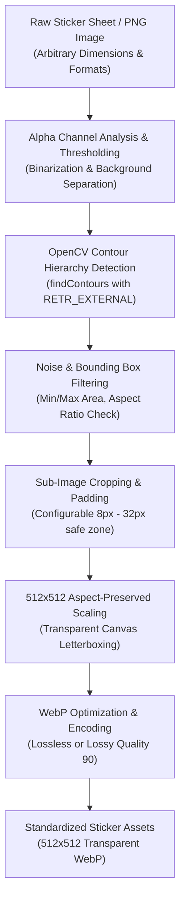

# img_tool

Automated image processing worker, OpenCV sticker sheet slicing engine, and standalone developer CLI utility for Restick.

---

## 📖 Overview

`img_tool` is the computer vision and image processing workhorse of the Restick platform. Written in Python 3.12, it fulfills two complementary roles:

1. **Background Microservice Worker**: Connects to the internal gRPC mesh to asynchronously slice uploaded sticker sheets and normalize graphic assets into standardized WebP formats.
2. **Standalone Developer & Designer CLI**: A local command-line utility for artists to inspect, slice, test, and optimize sticker assets before uploading them to the platform.

---

## 🔬 Image Processing Pipeline



### 1. Alpha Thresholding & Contour Detection
Extracts the alpha mask from 32-bit RGBA images, eliminating background noise and finding connected components representing distinct sticker items.

### 2. Dimension Normalization (512×512 Standard)
All messaging platforms (Telegram, WhatsApp, iMessage, Discord) require sticker dimensions to fit strictly within **512×512 pixels**:
- If an asset is `400×250`, it is scaled proportionally to `512×320` and centered inside a `512×512` transparent canvas.
- No stretching or aspect ratio distortion occurs.

---

## 💻 Standalone CLI Usage Guide

### 1. Installation
Install `img_tool` locally in a Python virtual environment:

```bash
cd services/img_tool
python3 -m venv venv
source venv/bin/activate
pip install -e .
```

Verify installation:
```bash
img_tool --help
```

---

### 2. Slicing a Composite Sticker Sheet (`img_tool slice`)

Automatically extracts individual stickers from a composite sheet image:

```bash
img_tool slice ./testdata/sample_sheet.png \
  --out-dir ./output_stickers \
  --padding 16 \
  --min-area 400 \
  --size 512 \
  --format webp
```

#### CLI Options for `slice`:
| Flag / Option | Type | Default | Description |
| :--- | :--- | :--- | :--- |
| `INPUT_PATH` | Argument (File) | *Required* | Path to the composite sticker sheet image (PNG/WebP) |
| `--out-dir`, `-o` | Option (Dir) | `./output` | Output directory where sliced stickers will be saved |
| `--padding`, `-p` | Option (Int) | `16` | Padding (in pixels) added around each detected sticker contour |
| `--min-area` | Option (Int) | `200` | Minimum bounding box pixel area to ignore noise specks |
| `--size`, `-s` | Option (Int) | `512` | Target square canvas dimension (e.g. 512 for 512x512) |
| `--format`, `-f` | Option (Str) | `webp` | Export format (`webp` or `png`) |

---

### 3. Normalizing a Single Sticker (`img_tool normalize`)

Takes an arbitrary single image file and centers it inside a 512×512 transparent canvas:

```bash
img_tool normalize ./raw_sticker.png \
  --out ./sticker_512.webp \
  --size 512 \
  --quality 90
```

#### CLI Options for `normalize`:
| Flag / Option | Type | Default | Description |
| :--- | :--- | :--- | :--- |
| `INPUT_PATH` | Argument (File) | *Required* | Path to raw input image |
| `--out`, `-o` | Option (File) | *Required* | Destination path for the normalized asset |
| `--size`, `-s` | Option (Int) | `512` | Canvas width and height in pixels |
| `--quality`, `-q` | Option (Int) | `90` | WebP compression quality (1-100) |

---

## ⚙️ Microservice Configuration (Environment Variables)

| Environment Variable | Default Value | Description |
| :--- | :--- | :--- |
| `IMG_HTTP_ADDR` | `:8080` | Bind address for HTTP liveness/health probe |
| `IMG_GRPC_ADDR` | `:50053` | Bind address for gRPC worker service |
| `IMG_TOOL_ENGINE` | `simple` | Processing engine (`simple` or `contour`) |
| `PUBLIC_FTP_ORIGIN` | `http://localhost:8081` | Origin used for generating download URLs |
| `INTERNAL_TOKEN` | `dev-internal-token` | Token for authenticating callbacks to `api_svc` |
| `FTP_HTTP_URL` | `http://ftp_svc:8080` | Internal URL for uploading processed assets to `ftp_svc` |
| `API_SVC_GRPC_ADDR` | `api_svc:50051` | gRPC address of `api_svc` |
| `FTP_SVC_GRPC_ADDR` | `ftp_svc:50052` | gRPC address of `ftp_svc` |

---

## 🚀 Running as a Microservice

### With Python Directly
```bash
cd services/img_tool
source venv/bin/activate
python -m img_tool.interfaces.serve
```

### With Docker Compose
```bash
docker compose up -d img_tool
```

### Health Check
```bash
curl -s http://localhost:8090/healthz
# Response: {"status":"ok","service":"img_tool"}
```
